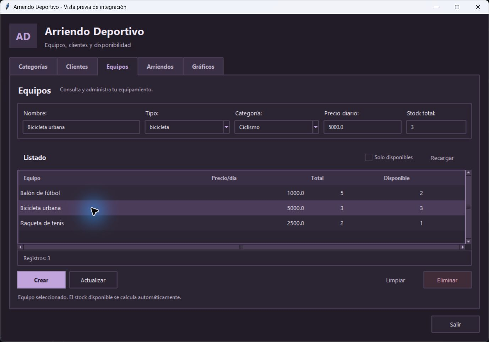
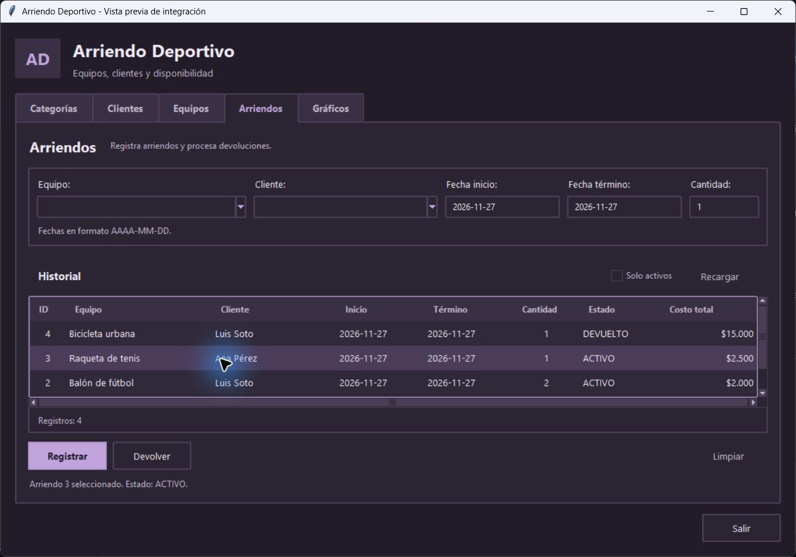
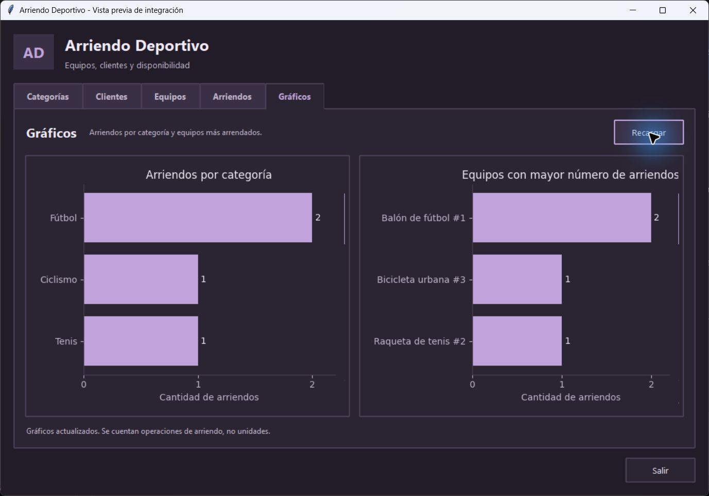

# Arriendo Deportivo

Aplicación de escritorio para administrar el arriendo de equipamiento deportivo. Permite registrar categorías, equipos y clientes, controlar el stock, realizar arriendos, procesar devoluciones y consultar gráficos.

Proyecto de Programación II, Universidad Católica de Temuco. Integrantes: Cristóbal y Franco.

## Tecnologías y requisitos

Python 3.13 o superior, SQLAlchemy ORM, SQLite, Tkinter con ttk y Matplotlib. Se utiliza Factory Method para crear los distintos tipos de equipamiento.

Las dependencias externas están en `requirements.txt`. La instalación de Python debe incluir Tkinter con Tcl/Tk.

## Instalación en Windows

Clona el repositorio o descarga su ZIP y abre una terminal en la carpeta del proyecto:

```powershell
git clone https://github.com/francou-ops/arriendo-deportivo.git
cd arriendo-deportivo
```

Crea el entorno e instala las dependencias:

```powershell
python -m venv .venv
.\.venv\Scripts\python.exe -m pip install -r requirements.txt
```

## Datos de ejemplo y ejecución

Ejecuta los comandos desde la carpeta del proyecto. Para generar la base con datos de ejemplo:

```powershell
.\.venv\Scripts\python.exe seeder.py
```

Se crean tres categorías, cinco equipos, tres clientes y siete arriendos: cuatro devueltos y tres activos. Si ya existe alguna categoría, el generador termina sin volver a cargar los ejemplos.

Para abrir la aplicación:

```powershell
.\.venv\Scripts\python.exe main.py
```

`main.py` crea las tablas que falten y abre la ventana. Los datos se guardan en `arriendos.db` dentro de la carpeta del proyecto y se conservan al cerrar. También se puede iniciar sin cargar ejemplos e ingresar los datos desde los formularios.

## Uso de la aplicación

| Pestaña | Funciones |
|---|---|
| Categorías | Crear, consultar, actualizar y eliminar categorías |
| Clientes | Crear, consultar, actualizar y eliminar clientes |
| Equipos | Administrar equipos, precios y stock; filtrar los disponibles |
| Arriendos | Registrar arriendos, devolverlos, consultar el historial y filtrar los activos |
| Gráficos | Mostrar arriendos por categoría y los cinco equipos más arrendados |

Para modificar o eliminar un registro, selecciónalo en la tabla. **Limpiar** restablece el formulario. Los datos se actualizan al entrar a cada pestaña y al pulsar **Recargar**.

En Arriendos, selecciona un equipo y un cliente, usa fechas en formato `AAAA-MM-DD` e ingresa la cantidad. Los mensajes de resultado aparecen debajo de las acciones. El teléfono del cliente y la descripción de la categoría son opcionales.

Los gráficos usan el historial de la base de datos, incluyendo arriendos activos y devueltos. Cuentan operaciones, no unidades: arrendar tres balones en una operación cuenta como un arriendo. Si no hay arriendos, se muestra un mensaje.

## Modelo de datos

Las clases de `models.py` representan las tablas. SQLAlchemy permite consultar y guardar sus objetos mediante sesiones. SQLite conserva esos datos al cerrar la aplicación.

| Entidad | Datos que guarda | Relaciones |
|---|---|---|
| `Categoria` | `id`, `nombre` único, `descripcion` | Tiene muchos equipos |
| `Equipo` | `id`, `nombre`, `tipo`, `categoria_id`, `precio_diario`, `stock_total`, `stock_disponible` | Pertenece a una categoría y tiene arriendos |
| `Cliente` | `id`, `nombre`, `correo` único, `telefono` | Tiene muchos arriendos |
| `Arriendo` | `id`, `equipo_id`, `cliente_id`, `fecha_inicio`, `fecha_fin_prevista`, `cantidad`, `estado`, `costo_total` | Pertenece a un equipo y a un cliente |

Cada arriendo corresponde a un equipo y puede incluir varias unidades. Su devolución es completa. Las claves foráneas se activan en `conexion.py` para mantener las relaciones entre las tablas.

## Reglas y validaciones

- Los campos de texto obligatorios no pueden quedar vacíos.
- El nombre de una categoría y el correo de un cliente no pueden repetirse.
- El precio diario debe ser positivo y finito. El stock total debe ser un entero mayor o igual a cero.
- El stock disponible no puede ser negativo ni superar el total.
- Un arriendo requiere un equipo y un cliente existentes.
- La cantidad debe ser un entero positivo y no superar el stock disponible.
- La fecha de término no puede ser anterior a la fecha de inicio.
- Registrar el arriendo y descontar stock se realiza en la misma transacción.
- Solo se pueden devolver arriendos activos. Una segunda devolución se rechaza.
- No se puede eliminar una categoría con equipos, ni un equipo o cliente con arriendos registrados, aunque estén devueltos.
- Al cambiar el stock total de un equipo, se conservan las unidades que están arrendadas.

## Factory Method

### Por qué se usa

Los equipos pueden calcular su costo de forma distinta. Factory Method permite crear el objeto del tipo correcto y llamar a su método `calcular_costo`, sin poner todas las fórmulas dentro del registro de arriendos.

Una categoría agrupa equipos, por ejemplo Fútbol. El tipo de equipo, como `balon` o `proteccion`, determina cómo se calcula su costo.

### Partes del patrón

| Parte | Clases |
|---|---|
| Producto | `TipoEquipo` |
| Productos concretos | `Balon`, `Raqueta`, `Bicicleta`, `Proteccion` |
| Creador | `FabricaEquipo`, que declara el método `crear` |
| Creadores concretos | `FabricaBalon`, `FabricaRaqueta`, `FabricaBicicleta`, `FabricaProteccion` |

Las fábricas concretas implementan `crear` y devuelven el producto correspondiente. `crear_tipo_equipo` elige una de ellas usando el diccionario `FABRICAS`.

Para agregar otro tipo, se crean su producto y su fábrica, y se registra la fábrica en `FABRICAS`.

### Integración con los datos

`Equipo.tipo` guarda el tipo como texto. Al registrar un arriendo, `calcular_costo_arriendo` usa ese texto para obtener el objeto correcto y calcular el costo.

El resultado se redondea y se guarda en `Arriendo.costo_total`. Así, cambiar después el precio de un equipo no cambia el costo de los arriendos que ya estaban registrados.

### Reglas de costo

Los días incluyen el inicio y el término: un arriendo con ambas fechas iguales cuenta como un día.

| Tipo | Cálculo |
|---|---|
| Balón | `precio_diario * dias * cantidad` |
| Raqueta | `precio_diario * dias * cantidad` |
| Bicicleta | `(precio_diario * dias + 10000) * cantidad`: agrega una garantía de $10.000 por unidad |
| Protección | `precio_diario * dias * cantidad * 0.8`: aplica un descuento de 20% |

La devolución cambia el estado y repone stock. El costo guardado se conserva en el historial.

## Capturas

Capturas tomadas con datos de prueba.

### Equipos



### Arriendos



### Gráficos



## Pruebas de demostración

Los seis pasos siguientes fueron comprobados con una base temporal. Se pueden repetir desde la interfaz usando una categoría, un equipo y un cliente de prueba.

| Paso | Acción | Resultado esperado y comprobado |
|---|---|---|
| 1 | Crear una categoría y un equipo con stock total 5 | Stock disponible 5 |
| 2 | Crear un cliente y arrendar 2 unidades | Stock disponible 3 y estado `ACTIVO` |
| 3 | Intentar arrendar otras 4 unidades antes de devolver | Operación rechazada; el stock sigue en 3 |
| 4 | Seleccionar el primer arriendo y devolver sus 2 unidades | Stock disponible 5 y estado `DEVUELTO` |
| 5 | Con Solo activos desmarcado, intentar devolver otra vez el mismo arriendo | Operación rechazada; el stock sigue en 5 |
| 6 | Cerrar y reabrir la aplicación y entrar a Gráficos | Los datos se conservan y aparecen los dos gráficos basados en la BD |

También se comprobaron datos vacíos, categorías y correos repetidos, precios y cantidades inválidos, restricciones de eliminación, actualización del stock y mensajes visibles en el tamaño mínimo de la ventana.

## Entrega

El repositorio o ZIP debe incluir el código fuente, este README, `requirements.txt` y las capturas. La base de ejemplo se genera con `seeder.py`. Para preparar un ZIP, se deben excluir `.venv`, `__pycache__`, archivos `.pyc` y archivos temporales.

## Fuentes consultadas

- [Python: Tkinter](https://docs.python.org/3.13/library/tkinter.html). Ventanas, eventos y organización de los controles.
- [Python: ttk](https://docs.python.org/3.13/library/tkinter.ttk.html). Pestañas, tablas, listas y estilos de los controles.
- [Matplotlib: Embed in Tk](https://matplotlib.org/stable/gallery/user_interfaces/embedding_in_tk_sgskip.html). Integración de figuras mediante `FigureCanvasTkAgg`.
- [SQLAlchemy: relaciones del ORM](https://docs.sqlalchemy.org/en/21/orm/basic_relationships.html). Relaciones entre categorías, equipos, clientes y arriendos.
- [SQLite: claves foráneas](https://www.sqlite.org/foreignkeys.html). Restricciones para conservar las relaciones entre los datos.
- [Python: clases abstractas con abc](https://docs.python.org/3.13/library/abc.html). Uso de `ABC` y `abstractmethod` en los productos y creadores.
- [Python: entornos virtuales](https://docs.python.org/3.13/library/venv.html). Creación del entorno para instalar las dependencias.
- Claude (Anthropic), asistente de IA: fuente de información sobre Factory Method y apoyo en la redacción del README.
